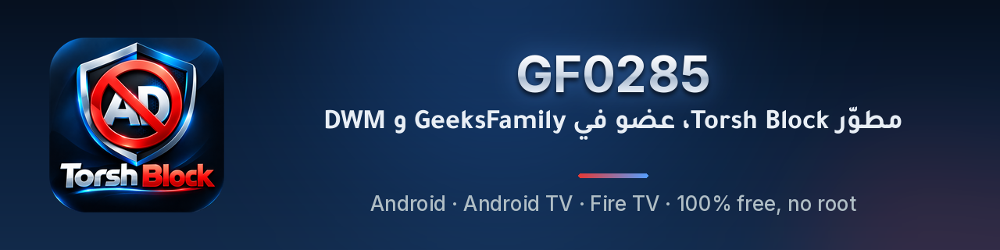
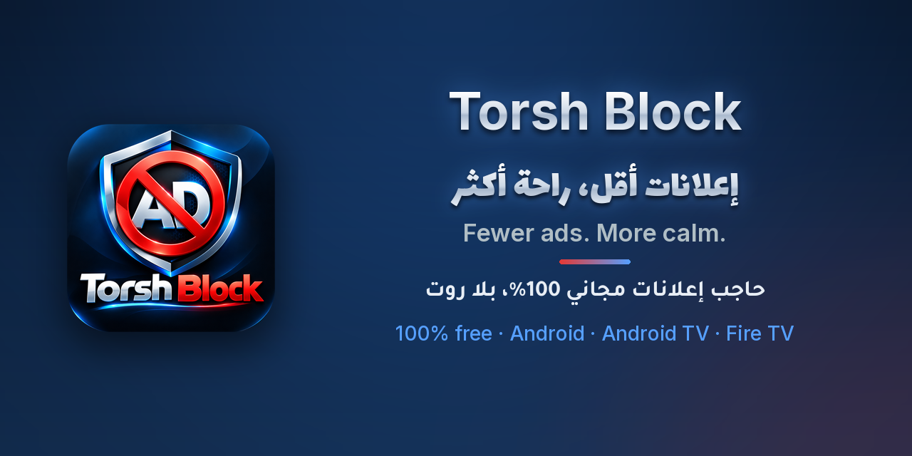

<p align="center">
  
</p>

<div dir="rtl" align="right">

## مرحبًا 👋

**<span dir="ltr">GF0285</span>**، مطوّر تطبيق <span dir="ltr">Torsh Block</span>، وعضو في <span dir="ltr">GeeksFamily</span> و <span dir="ltr">DWM</span>.

أبني تطبيقات أندرويد مجانية تحترم خصوصيتك وتعمل بلغتك، على الهاتف والتلفاز.

### ⭐ المشروع المميّز

</div>

<table>
  <tr>
    <td width="45%"><a href="https://github.com/GF0285/torsh-block"></a></td>
    <td>
      <h3><a href="https://github.com/GF0285/torsh-block">Torsh Block</a></h3>
      <div dir="rtl" align="right">
        <p><b>إعلانات أقل، راحة أكثر.</b> حاجب إعلانات مجاني 100% لأندرويد والتلفاز (<span dir="ltr">Android TV</span> و<span dir="ltr">Fire TV</span>)، بدون روت. يحجب الإعلانات والمتتبّعات في كل التطبيقات، مع <span dir="ltr">DNS</span> مشفّر ووضع تجاوز <span dir="ltr">DPI</span>، وواجهة بالعربية والدارجة.</p>
      </div>
      <p><b>Fewer ads. More calm.</b> A 100% free ad blocker for Android, Android TV &amp; Fire TV, no root. Blocks ads and trackers in every app, with encrypted DNS, a DPI bypass mode and an Arabic / Darija UI.</p>
      <p>
        <a href="https://github.com/GF0285/torsh-block/releases/latest"></a>
        <a href="https://github.com/GF0285/torsh-block/releases"></a>
        
        
        
      </p>
      <p><a href="https://github.com/GF0285/torsh-block/releases/latest"><b>⬇️ تنزيل آخر إصدار · Download the latest release</b></a></p>
    </td>
  </tr>
</table>

<div dir="rtl" align="right">

### 💙 ادعم عملي
تطبيقاتي مجانية 100%. إن أردت دعمي، يمكنك التبرع بعملة **<span dir="ltr">GRAM</span>** على شبكة **<span dir="ltr">TON</span>** فقط:

</div>

```
UQDUobwrdGFonu5sWIyyEn7WOwcT-uwuGoKYECwrQq2KdjYR
```

---

## Hi 👋

**GF0285** — developer of Torsh Block, member of GeeksFamily and DWM.

I build free Android apps that respect your privacy and speak your language, on phones and TVs.

### 💙 Support my work
My apps are 100% free. If you'd like to support me, you can donate **GRAM on the TON network** (GRAM on TON only) to the wallet above.

<p align="center" dir="rtl">صُنع بـ ♥️ من طرف <span dir="ltr">GF0285</span> عضو كل من <span dir="ltr">GeeksFamily</span> و <span dir="ltr">DWM</span></p>
<p align="center">Made with ♥️ by GF0285, member of GeeksFamily and DWM</p>
